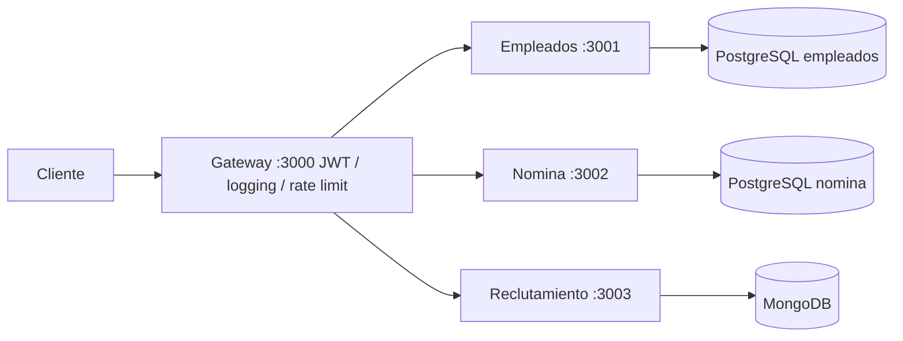

# RRHH SOA - Practica 2

Sistema REST con API Gateway, autenticacion JWT y servicios independientes de empleados, nomina y reclutamiento. PostgreSQL separado por dominio y MongoDB para reclutamiento. Los servicios se comunican por HTTP y solo el Gateway publica un puerto en el equipo.

## Ejecutar con Docker

1. Abre Docker Desktop y espera a que el motor este activo (contenedores Linux).
2. En esta carpeta ejecuta:

```powershell
docker compose up --build -d --wait
```

No hace falta instalar Node ni bases de datos en el equipo. El primer arranque descarga imagenes y dependencias. Puedes usar `Copy-Item .env.example .env` para personalizar el puerto y los secretos antes del primer arranque. Los valores predeterminados son para la practica local. Usuarios de demostracion: `admin` y `rrhh`, ambos con clave `1234`. El token dura 8 horas.

```powershell
Invoke-RestMethod http://localhost:3000/health
$login = Invoke-RestMethod http://localhost:3000/auth/login -Method Post -ContentType 'application/json' -Body '{"usuario":"admin","password":"1234"}'
$headers = @{ Authorization = "Bearer $($login.token)" }
Invoke-RestMethod http://localhost:3000/api/empleados -Headers $headers
```

```powershell
docker compose ps
docker compose logs -f
docker compose down
```

`down` conserva los datos. `docker compose down -v` elimina permanentemente los datos de la practica. Cambiar la clave PostgreSQL en `.env` no modifica las claves de bases que ya estan inicializadas.

## Probar

Con Node.js 22 o superior instalado, desde la raiz:

```powershell
npm test
npm run test:integration
```

La segunda orden necesita el sistema en ejecucion: comprueba login, rechazo sin token, creacion y edicion de empleado, duplicados, nomina, vacantes, candidatos y baja logica. Crea registros de demostracion y los conserva para inspeccion. Para otro puerto: `$env:BASE_URL='http://localhost:3005'`.

## Endpoints

| Metodo | Ruta | Accion |
|---|---|---|
| POST | /auth/login | Obtener JWT con usuario y password |
| GET | /health | Estado del proceso Gateway |
| GET | /metrics | Metricas Prometheus del Gateway |
| GET, POST | /api/empleados | Listar (filtro departamento) / crear |
| GET, PUT, DELETE | /api/empleados/:id | Consultar / actualizar / desactivar |
| POST | /api/nomina/calcular | Registrar rol de pago |
| GET | /api/nomina/:empleado_id | Historial |
| GET | /api/nomina/:empleado_id/:periodo | Rol por periodo |
| GET, POST | /api/reclutamiento/vacantes | Listar (filtro estado) / publicar |
| GET, PUT | /api/reclutamiento/vacantes/:id | Consultar / editar |
| GET, POST | /api/reclutamiento/candidatos | Listar (estado, vacante_id) / registrar |
| PUT | /api/reclutamiento/candidatos/:id/estado | Cambiar estado y notas |

Todas las rutas `/api` requieren `Authorization: Bearer TOKEN`. Formatos y ejemplos completos de cuerpos: `scripts/smoke.js` y `requests.http`.

La nomina usa salario / 240 * 1.5 para horas extra. Se redondea el total de extras a centavos antes de calcular el neto: salario 1500, 5 horas extra, bono 100 y descuentos 67.50 producen extras 46.88 y neto 1579.38. Es el calculo academico del enunciado. Hay un registro unico por empleado y periodo.

## Arquitectura



Cada servicio espera a que su base este saludable. El Gateway espera a los tres servicios. Las tablas se crean al arrancar, sin alterar ni borrar tablas existentes. Los contenedores reinician ante fallos. Winston emite logs JSON a la salida del contenedor. Limite del Gateway: 100 peticiones por minuto por IP. `/health` de cada servicio verifica su base; `/health` del Gateway indica que su proceso responde, y `docker compose ps` permite revisar la salud de todo el conjunto.

## Monitoreo opcional

```powershell
docker compose --profile monitoring up -d
```

Prometheus en http://localhost:9090 consulta `/metrics` de los cuatro componentes. Consulta de ejemplo: `http_requests_total`. Los servicios publican eventos de operaciones exitosas en Redis Pub/Sub; los otros componentes los reciben y registran con Winston. Se usa el canal `rrhh.eventos`. Son notificaciones de demostracion sin datos personales ni garantia de entrega: Redis Pub/Sub no conserva mensajes para consumidores desconectados. El informe PDF y las capturas de la practica son entregables separados del codigo.

## Estructura y desarrollo local

- `gateway/src`: login, JWT y enrutamiento. El proxy elimina `/api` y conserva el nombre del dominio; reenvia tambien cuerpos JSON.
- `services/empleados/src`: CRUD Sequelize y baja logica.
- `services/nomina/src`: calculo e historial Sequelize.
- `services/reclutamiento/src`: vacantes y candidatos Mongoose.
- `shared`: manejo de errores, logging, metricas y calculo de nomina.
- `docker-compose.yml`: cuatro aplicaciones, tres bases, Redis y monitoreo opcional.

Para desarrollo fuera de Docker: ejecuta `npm ci` en la raiz para instalar los workspaces, configura las variables listadas en los `.env.example` de cada componente y utiliza `npm start --workspace gateway` o el servicio correspondiente. Las bases deben estar accesibles en las URLs configuradas. Los `.env` locales se leen desde el directorio actual; tambien puedes exportar las variables en tu terminal. Docker ya pasa toda la configuracion necesaria.

## Solucion de problemas

- Error `dockerDesktopLinuxEngine`: inicia Docker Desktop y su motor Linux.
- Puerto 3000 ocupado: configura `GATEWAY_PORT=3005` en `.env` y vuelve a levantar.
- Servicio no saludable: revisa `docker compose logs empleados nomina reclutamiento`.
- Respuesta 401: inicia sesion y envia el token como Bearer.
- Respuesta 409: cedula o nomina del mismo periodo duplicada.
- Respuesta 503: servicio destino no disponible; revisa su salud y logs.

## Dependencias

Se actualizaron Express, Mongoose, Sequelize y el proxy a versiones corregidas. La auditoria actual aun informa 5 avisos transitivos: braces/micromatch a traves del proxy y uuid a traves de Sequelize. No se aplican degradaciones incompatibles sugeridas por audit. Este proyecto esta configurado para la demostracion local de la practica; el login usa usuarios de ejemplo.

